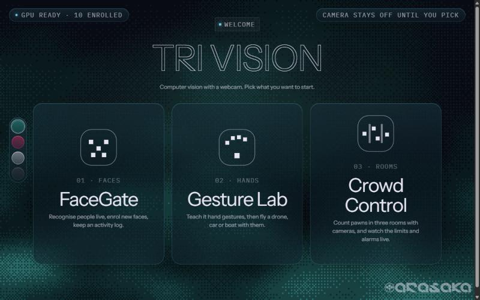
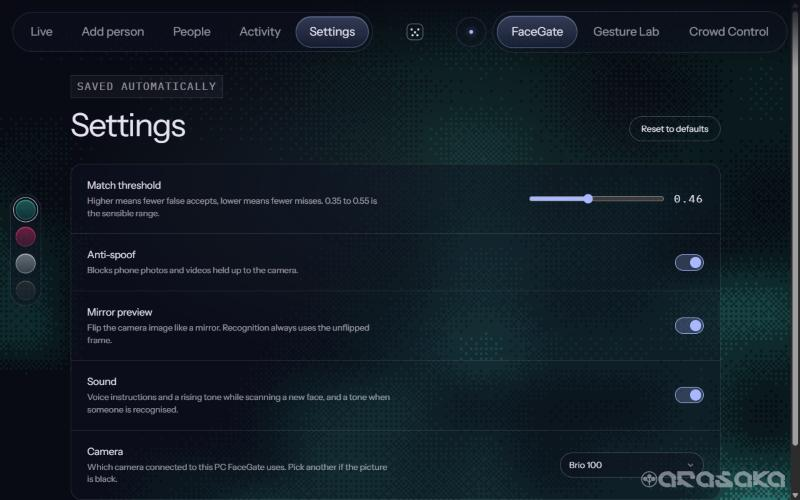
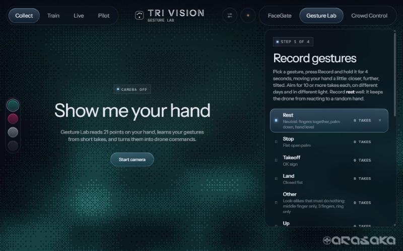
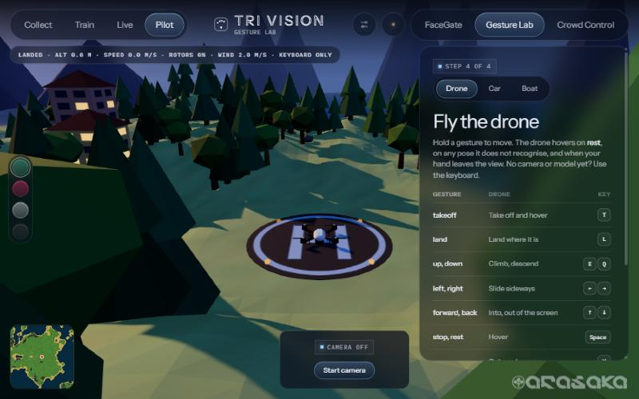
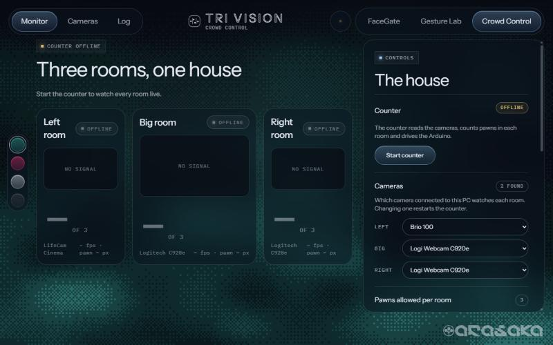

# TriVision

**Three computer-vision apps, one webcam-powered toolkit: recognise faces, fly a drone with your hand, and keep a crowd safe.**

> **Headline:** FaceGate runs real-time face recognition **and** anti-spoofing entirely offline on a 6 GB laptop GPU, at about **25 FPS at 1080p**, and no face image ever leaves the PC.

A Grade 12 student project. This repository is a **showcase only**: it documents what the project does and how it works. The source code is not published (see [Licence](#licence)).

---

## Table of contents

1. [Overview](#overview)
2. [Screenshots](#screenshots)
3. [The three apps](#the-three-apps)
4. [Features](#features)
5. [How it works](#how-it-works)
6. [Architecture and tech stack](#architecture-and-tech-stack)
7. [Security and privacy](#security-and-privacy)
8. [Requirements and configuration](#requirements-and-configuration)
9. [Results](#results)
10. [Status, limitations and roadmap](#status-limitations-and-roadmap)
11. [How I built it](#how-i-built-it)
12. [Credits](#credits)
13. [Licence](#licence)

---

## Overview

Cameras are everywhere, but most of what they see is never understood. TriVision asks a simple question three different ways: **what can a single webcam, a laptop GPU and some careful engineering do on their own, with no cloud?**

| | App | The problem it tackles | Port |
|---|---|---|---|
| 1 | **FaceGate** | Face recognition is easy to fool with a phone photo, and many systems upload faces to a server. FaceGate recognises people and checks the face is *live*, all on-device. | 8765 |
| 2 | **Gesture Lab** | Controlling a machine usually needs a controller. Gesture Lab lets you teach the computer *your own* hand gestures and fly a drone, car or boat with them. | 8800 |
| 3 | **Crowd Control** | When too many people crowd into one room it becomes dangerous, but nobody is counting. Crowd Control counts every room, warns early and opens the way to the emptier room. | 8830 |

The three apps share one visual design and a switcher, and run side by side on Windows.

---

## Screenshots


*The welcome screen. Pick an app; the camera stays off until you do.*

| FaceGate: settings with camera picker | Gesture Lab: record your own gestures |
|---|---|
|  |  |
| *Match threshold, anti-spoof, mirror, sound and camera choice. Saved automatically.* | *Step 1 of 4: record takes of each gesture, with guidance on how many and how.* |

| Gesture Lab: fly the 3D drone | Crowd Control: three rooms, one house |
|---|---|
|  |  |
| *Gestures map to flight commands in a 3D stage. Keyboard works too.* | *Per-room counts and limits, a camera picker for each room, and the counter controls.* |

*Every screenshot is taken with the cameras off, so no faces, names or personal data appear.*

---

## The three apps

### 1. FaceGate: face recognition you can trust

A webcam pipeline that finds faces, works out who they are, and refuses to be fooled by a photo.

- Guided **5-pose enrolment** so matching works from any head angle.
- **Anti-spoofing** that blocks phone photos and screen replays.
- Live names with match scores; unknown faces stay "Unknown".
- Activity log, people management and a settings page, in a web UI with a camera picker.

### 2. Gesture Lab: teach it your hands

Hand tracking runs in the browser (21 landmarks per hand). You record your own gestures, train a small neural network on them in seconds, then use them to pilot a 3D drone, car or boat. Everything is bundled, so it works **fully offline**.

### 3. Crowd Control: early warning for crowded rooms

Demonstrated on a hand-built scale model of a building with three rooms and two automatic doors, where chess pawns stand in for people. Overhead cameras count each room with classic computer vision, and an Arduino opens a door and lights an arrow towards the emptier room, with nobody pressing a button.

---

## Features

### FaceGate

| Group | What it does |
|---|---|
| **Recognition** | Names enrolled people on sight; a name is shown only after a short vote across several frames. |
| **Enrolment** | 5-pose scan (front, left, right, up, down), about 8 samples per pose; spoken instructions, a rising tone while scanning and a countdown to clear the frame. |
| **Quality checks** | Pauses if someone else steps into view, rejects samples that do not look like the person being scanned, warns about light that is too dark, too bright or one-sided. |
| **Anti-spoof** | Two models check texture and depth cues; "Fake face" / "Spoof blocked" for photos and screens. |
| **Helpful states** | "Unknown", "Move closer", "Face covered", "Verifying". |
| **Pages** | Live, Add person, People, Activity (log with snapshots of spoof attempts) and Settings. |
| **Settings** | Match threshold, anti-spoof on/off, mirror preview, sound, camera choice. |

### Gesture Lab

| Group | What it does |
|---|---|
| **Collect** | Record takes of: stop, rest, takeoff (OK sign), land (fist), up, down, left, right, forward, back, plus an "other" class for look-alike shapes that must do nothing. |
| **Train** | A small neural network (MLP) trained in the browser, with smoothing and reject thresholds so unknown shapes are ignored. |
| **Live** | Shows the recognised gesture in real time. |
| **Pilot** | Drives a 3D stage with a drone, car or boat; keyboard and gamepad also supported. Can talk to a real ESP32 drone through a bridge script. |
| **Offline** | Hand model, libraries and fonts are all bundled. |

### Crowd Control

| Group | What it does |
|---|---|
| **Counting** | OpenCV only (no trained AI): finds people-sized shapes per room, including pawns that touch. |
| **Calibration** | Each room has its own floor outline and learned size, so shadows, walls and a hand reaching in do not change the count. |
| **States** | OK, WARN (at the limit) or OVER (above it); an alarm clears only after two seconds within the limit, so it does not flicker. |
| **Hardware** | Arduino UNO drives an LED, a buzzer, a servo and a stepper for the two doors, and an 8x8 LED matrix arrow. |
| **Smart exit** | Opens the door to the emptier room and points the arrow there. If every room is full, both doors open and the screen shows an X: nowhere to go. |
| **Dashboard** | Live room cards, a camera picker for each room (up to three cameras) and settings. |

---

## How it works

### FaceGate pipeline

```
 Webcam (1080p)
      |
      v
 SCRFD-10G  ----->  face box + 5 landmarks (eyes, nose, mouth corners)
      |
      v
 Align + crop to 112x112
      |
      +-----> MiniFASNet x2  ----->  live person?  (liveness comes first)
      |
      v
 ArcFace R50  ----->  512-number "fingerprint" (L2-normalised)
      |
      v
 Cosine match against the enrolled gallery
      |
      v
 Vote over recent frames  ----->  name shown only if live AND vote passes
```

Design decisions behind it:

- **GPU first, CPU fallback.** ONNX Runtime with CUDA; the FPS overlay shows `[GPU]` or `[CPU]`.
- **Speed through scheduling.** The detector runs every 2nd frame and the slower recognition step every 3rd frame per tracked face, with tracking in between.
- **Stability over flash.** A new face needs a stronger vote (0.52) to be named than to keep its name (0.46), and a match must beat the runner-up by a margin. One lucky frame no longer shows a wrong name.
- **Liveness before identity.** Once a face is verified live it stays live while tracked; only three confident fakes in a row revoke it.
- **Pose-aware gallery.** Each person is stored from five angles, so a turned head is compared with turned-head samples.
- **Honest preview.** The preview can be mirrored for the user, but recognition always uses the original image.

### Gesture Lab flow

```
 Webcam -> MediaPipe hand landmarks (21 points)
        -> record takes per gesture (Collect)
        -> train MLP in the browser (Train)
        -> smoothing + reject threshold
        -> recognised gesture (Live)
        -> drone / car / boat commands (Pilot) -> optional ESP32 drone
```

### Crowd Control loop

```
 Overhead cameras (one per room)
        |
        v
 OpenCV: room floor mask -> shapes -> people-sized blobs -> count per room
        |
        v
 Room state: OK / WARN / OVER (with 2 s hold before clearing)
        |
        v   about 5 times a second, over USB serial
 Arduino UNO
   WARN: light blinks slowly
   OVER: buzzer, fast blink, door opens, arrow lights towards the emptier room
```

---

## Architecture and tech stack

| Layer | Technology |
|---|---|
| Languages | Python 3.13, TypeScript, JavaScript, Arduino C++ |
| Face recognition | ONNX Runtime (CUDA), OpenCV, NumPy, Pillow |
| Models | SCRFD-10G (detection) and ArcFace R50, WebFace600K (recognition), both from InsightFace; MiniFASNetV2 and MiniFASNetV1SE (anti-spoof) |
| FaceGate web app | FastAPI + uvicorn backend, WebSocket video stream, React + Vite frontend, shown in a browser or pywebview window |
| FaceGate desktop app | PySide6 (Qt), kept as a backup interface |
| Gesture Lab | MediaPipe Hand Landmarker, three.js, in-browser MLP, runs offline |
| Crowd Control | OpenCV counting, Python web server, Arduino UNO firmware (Servo, LedControl) |
| Hardware | Windows 11, NVIDIA RTX 3050 (6 GB), 1080p webcam at 30 FPS; Arduino UNO, servo, stepper, buzzer, 8x8 MAX7219 matrix, scale-model building |

Code organisation (conceptual):

```
 engine        GPU sessions: detector, embedder, anti-spoof
 live loop     tracking, throttled embedding, voting
 enrolment     guided multi-pose scan
 database      enrolled-face storage and matching
 settings      all tunables in one place
 web server    FastAPI + WebSocket, shared by the UI
 UIs           React web app / Qt desktop app / plain OpenCV window
```

The engine returns data and each UI draws its own overlay, so the same recognition core serves the web app, the desktop app and the plain camera window.

---

## Security and privacy

- **Offline by design.** No cloud, no uploads. Face data stays on the PC in a local folder.
- **Nothing personal in the code repository.** Face data, models, recorded gesture takes and camera calibration are personal to each install and are never committed.
- **Embeddings, not photos, do the matching.** Recognition compares 512-number fingerprints that are L2-normalised.
- **Spoof resistance.** Photos and screen replays are blocked, and spoof attempts are logged with snapshots.
- **Each person enrols on their own machine.** Nothing is shared between installs.
- **Gesture recordings stay in the browser** that made them.

---

## Requirements and configuration

| Item | Requirement |
|---|---|
| OS | Windows 10/11 |
| Python | 3.13 |
| Camera | Any webcam (Crowd Control uses up to three) |
| GPU | NVIDIA card recommended for FaceGate; without one it falls back to the CPU, which is slower |
| Browser | Any modern browser (Gesture Lab and the web UI) |
| Arduino | Optional, only for the Crowd Control house |

Tunable behaviour, in plain terms:

| Setting | Effect |
|---|---|
| Match threshold (default 0.46, sensible range 0.35 to 0.55) | Higher means fewer false accepts; lower means fewer misses. |
| Anti-spoof on/off | Turns the live-face check on or off. |
| Mirror preview | Flips the preview only; recognition uses the original frame. |
| Camera | Picks which webcam each app (and each Crowd Control room) uses. |
| Pawns allowed per room | Sets each room's limit in Crowd Control. |

---

## Results

Measured on one machine (RTX 3050 6 GB, 1080p webcam):

| Measure | Result |
|---|---|
| Correct identifications | 60 out of 60 (enrol, then recognise, on the real webcam) |
| False matches | 0 out of 120 on background faces (highest score 0.23) |
| Speed | About 25 FPS at 1080p on the GPU, covering detection, recognition and anti-spoof together |
| Anti-spoof on real faces | Scores 0.85 to 0.999, median 0.99 |

These figures come from tests with a small group, on one webcam, in one room. The match threshold was raised from 0.42 to 0.46 after the 60/60 and 0/120 results were recorded, because a look-alike scored 0.42; those two tests were not re-run at 0.46.

---

## Status, limitations and roadmap

**Status:** all three apps work on my own hardware. FaceGate's web interface, Gesture Lab and Crowd Control are the current versions; the older Qt desktop app is kept as a frozen backup.

**Honest limitations**

- **Lighting:** recognition across very different lighting (daylight vs night) has not been verified.
- **Camera feed:** the web interface was not re-verified on a live camera after a black-frame issue found in October 2026.
- **Anti-spoof angles:** one of the two anti-spoof models is less stable at some head angles, which is why a face must pass an averaged check.
- **"Face covered":** tuned on measured readings plus simulated ones, not on a large recorded test.
- **Small test group:** results above come from a small group, one webcam and one room.
- **Crowd Control** is demonstrated on a scale model with pawns, not on a real building.
- **Models:** the InsightFace models are licensed for non-commercial research use only.

**Roadmap**

- Re-run the accuracy tests at the current threshold, with more people and more cameras.
- Test recognition in varied lighting.
- Test Crowd Control with different camera heights and lighting.

---

## How I built it

I'm a Grade 12 student, and TriVision started as three ideas in my head. My part:

- **Ideas and direction:** came up with the three projects and what each should do: the 5-pose enrolment, the OK/WARN/OVER room logic, which door the arrow points to. I kept refining until each matched what I wanted.
- **Requirements:** set the constraints that shaped the technology: real-time on a 6 GB laptop GPU, works offline, runs on Windows, one shared design across the apps, a camera picker in every app, and a web UI held to a premium design bar.
- **Hardware:** built the scale-model building and wired the Arduino, servo, stepper, buzzer and LED matrix.
- **Testing:** ran everything on real webcams and hardware, found what broke, and drove the fixes.

---

## Credits

- Face detection and recognition: [InsightFace](https://github.com/deepinsight/insightface) (SCRFD-10G, ArcFace R50 WebFace600K).
- Anti-spoof: MiniFASNet, from Silent-Face-Anti-Spoofing.
- Gesture Lab: MediaPipe Hand Landmarker and three.js.

---

## Licence

Copyright (c) 2026 A Abdul Hadi. All rights reserved.

This is my own work. No permission is granted to use, copy, modify or distribute it without my written permission. See [LICENSE](LICENSE).
